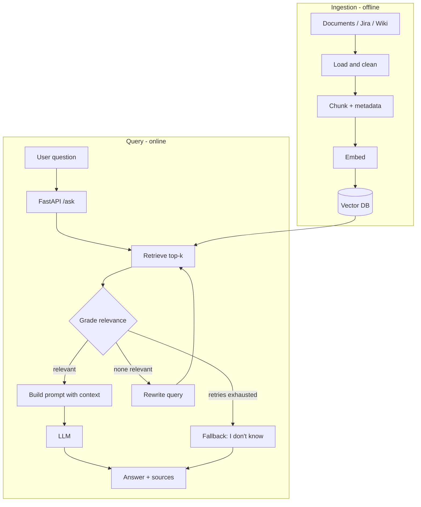

# Architecture

## Overview
The system has two paths: an **offline ingestion** path that builds the knowledge index, and an **online query** path that answers questions.

## Diagram

## Components
| Component | Responsibility | Technology |
|---|---|---|
| API layer | Validation, routing, responses | FastAPI + Pydantic |
| Orchestration | State, branching, retry loop | LangGraph |
| Retrieval | Semantic search with metadata filters | Chroma (FAISS optional) |
| Embeddings | Text -> vectors | [embedding model] |
| Generation | Grounded answer | [LLM] |
| Connectors | Pull data from sources | Jira REST API, file loaders |

## Design decisions
| Decision | Reason |
|---|---|
| Chunk size [800] tokens, overlap [100] | Balance context and retrieval precision; tune with evaluation |
| Relevance grading step | Filters weak matches before generation and reduces hallucination |
| Query rewrite loop (max 2) | Improves recall without risking infinite loops |
| Fallback answer | Prefer "I don't know" over a wrong answer |
| Metadata on every chunk | Enables source citations and filtering by source/instance |
| Secrets in environment variables | Keeps credentials out of the repository |

## Security and privacy notes
- No real customer or employer data in this repository
- API keys loaded from `.env` (git-ignored)
- Production would add authentication, per-user access filtering, PII masking, and audit logging

## Possible production deployment (AWS)
API on ECS/Fargate or Lambda behind API Gateway; documents in S3; vector store on OpenSearch or Aurora pgvector; secrets in Secrets Manager; logs and metrics in CloudWatch.
